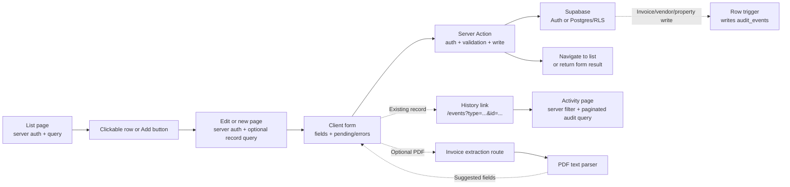

# List, New, Edit, and Activity Routes

**Applies to:** Next.js 16.4.2, React 19.3.0, and the Supabase server client used in `frontend/`.

The Vendors feature established the list → new/edit structure. Invoices follows it and reuses a single form for creation and editing, with an optional PDF extraction step. Users follows the same navigation and page layout, with a separate creation path because a new account is created in Supabase Auth. Activity (`/events`) is a read-only page for the audit history produced by invoice, vendor, and property writes. Read [Next.js Server / Client Pattern](./nextjs-server-client.md) and [Supabase Data Fetching](./supabase-data-fetching.md) for the underlying conventions.

## File map

```text
frontend/app/
├── api/invoices/extract/route.ts  POST /api/invoices/extract: parse a selected PDF
├── events/
│   ├── layout.tsx                 Route metadata
│   ├── page.tsx                   /events: server auth, URL filters, audit query, history list and pagination
│   └── FilterForm.client.tsx      Record/user picker; submits filters in the URL
├── vendors/
│   ├── layout.tsx                 Route metadata
│   ├── page.tsx                   /vendors: server auth, active vendor query, clickable list
│   ├── actions.ts                 Server Actions: save vendor and archive vendor
│   ├── VendorForm.client.tsx      Shared new/edit form; field state and action feedback
│   ├── new/
│   │   └── page.tsx               /vendors/new: auth check, then VendorForm
│   └── [id]/edit/
│       └── page.tsx               /vendors/:id/edit: validate ID, load vendor, then VendorForm
├── invoices/
│   ├── layout.tsx                 Route metadata
│   ├── page.tsx                   /invoices: server auth, active invoice query, clickable list
│   ├── actions.ts                 Server Actions: create, update, and archive invoices
│   ├── InvoiceForm.client.tsx     Shared new/edit fields; optional PDF preview and extraction
│   ├── invoice-form.module.scss   Layout and form styles shared by new and edit pages
│   ├── new/
│   │   └── page.tsx               /invoices/new: load vendor/property choices, then form
│   └── [id]/edit/
│       └── page.tsx               /invoices/:id/edit: load invoice and choices, then form
└── users/
    ├── layout.tsx                 Route metadata
    ├── page.tsx                   /users: admin check, profile query, clickable list
    ├── actions.ts                 Server Action: update profile name and role
    ├── UserForm.client.tsx        Edit form with a fixed set of role choices
    ├── new/
    │   ├── layout.tsx             Add-user page metadata
    │   ├── page.tsx               /users/new: admin check, then CreateUserForm
    │   ├── actions.ts             Server Action: create Supabase Auth account
    │   └── CreateUserForm.client.tsx  Account fields, pending state, result messages
    └── [id]/edit/
        └── page.tsx               /users/:id/edit: admin check, load profile, then UserForm
```

Shared pieces live outside the routes:

- [`ClickableTableRow.client.tsx`](../../frontend/components/ClickableTableRow.client.tsx) makes list rows open their edit page. The visible name or invoice reference remains a real link for keyboard access and opening a new tab.
- [`ArchiveButton.client.tsx`](../../frontend/components/ArchiveButton.client.tsx) supplies the confirmation and pending state for vendor, invoice, and property archiving. User profiles do not currently have an archive action.
- [`nav.tsx`](../../frontend/components/layout/nav.tsx) links the sidebar to resource lists and Activity, and supplies breadcrumb names for their routes. Activity sits under Manage, above Users.
- [`roles.ts`](../../frontend/lib/users/roles.ts) is the single list of selectable user roles and display labels.
- [`status.ts`](../../frontend/lib/invoices/status.ts) defines the selectable invoice statuses and display labels.
- [`extract-invoice.ts`](../../frontend/lib/invoices/extract-invoice.ts) and [`invoice-parser.ts`](../../frontend/lib/invoices/invoice-parser.ts) turn PDF text into suggested form values.

## Request and save flow



The `page.tsx` files keep the headings and layout on the server. They place request-time auth and data reads in an async child inside `<Suspense>`. Edit pages await the `[id]` route parameter, validate it, load one record, and return 404 when no record is available. Client form files contain only the interaction that needs React hooks. Server Actions repeat the auth check because a form action can be called without visiting its page.

Vendors write to `public.vendors`. The same `VendorForm.client.tsx` receives either an existing vendor or no vendor; `saveVendor` chooses update or insert. Archiving sets `deleted_at` and `deleted_by`, and the list excludes archived rows.

Invoices write to `public.invoices`. The list joins vendor and property names for display and excludes archived invoices. `/invoices/new` is the creation page; it loads active vendor and property choices on the server. The edit page loads the invoice plus its choices, retaining an archived vendor or property if that invoice already references it. Both render `InvoiceForm.client.tsx`, which calls the create or update Server Action in `invoices/actions.ts`. Those actions validate the input and references before writing. A new invoice shows its save result in the form. After a successful edit, the client navigates to `/invoices`; archiving redirects there from the Server Action. Invoice writes revalidate the list and Activity; edits and archives also revalidate the specific edit route before navigation. The edit form's History button opens Activity filtered to that invoice.

The new-invoice form can preview a selected PDF or image in the browser; it does not store the file. For a PDF, it posts to [`/api/invoices/extract`](../../frontend/app/api/invoices/extract/route.ts), which checks auth, validates the file, and calls the parser in `lib/invoices/`. Suggested values still require review, including matching vendor and property names to their IDs. The edit form uses the same component without its file-preview panel.

Users have two data sources. `/users/new` signs up an account through Supabase Auth; the database trigger creates its `public.profiles` row with the `clerk` role. `/users/[id]/edit` updates the profile name and role, while the account email and password remain in Supabase Auth. The page and action check for an admin, and the profile update policy in the role migration enforces that check in Postgres as well. The new-user action returns a success or error message on the form; successful vendor and user edits return to their lists. The user edit form's History button opens Activity filtered to actions **performed by** that user. Profile changes are not audit targets.

## Activity viewer

`/events` is a page route, not an API endpoint or a business form. Its `page.tsx` checks auth and reads `searchParams` in a `<Suspense>`-wrapped server component. With no filter, it shows recent events. A filter uses `?type=invoice|vendor|property|actor&id=<uuid>`; `actor` matches `actor_user_id`, while the other types match the event's target record. The small `FilterForm.client.tsx` only switches the available picker choices and submits a GET request. The server validates the filter, queries `public.audit_events` newest first, and shows 50 events at a time with URL-based pagination. It renders each event's actor, timestamp, action, changed fields, and reason when present.

The database trigger records invoice, vendor, and property changes in `audit_events`, with exactly one target per event. The existing audit indexes support target and actor filters. Vendor and invoice edit forms link to their own record history; the user edit form links to actions by that user. Properties currently uses a same-page edit form at `/properties?edit=<id>`, rather than a separate `[id]/edit` route. Vendor, invoice, and property write actions revalidate `/events` after a successful change. The viewer does not track changes to user profiles or combine a vendor/property's history with events on related invoices.

## Adding another list/new/edit feature

1. Put the list at `app/<resource>/page.tsx`, the add page at `new/page.tsx`, and the edit page at `[id]/edit/page.tsx`.
2. Keep Supabase reads and auth checks in server components. Wrap request-time reads in `<Suspense>`.
3. Put form interaction in a `*.client.tsx` leaf. Reuse it for new and edit when both operations have the same fields.
4. Put writes in a nearby `actions.ts`; validate input and authorization inside every action. Add the database policy needed to protect the same operation. Revalidate routes that display changed data before navigating away.
5. Add the list link and route names in `components/layout/nav.tsx`. If the resource is audited, link its edit form to `/events?type=<resource>&id=<uuid>` and revalidate `/events` after writes. Verify new routes in a production build.
