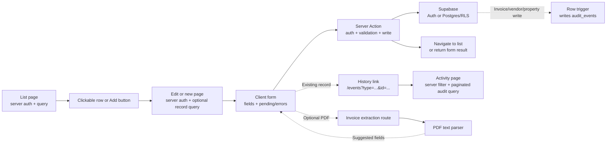

# List, New, Edit, and Activity Routes

**Applies to:** Next.js 16.4.2, React 19.3.0, and the Supabase server client used in `frontend/`.

The Vendors feature established the list → new/edit structure. Invoices follows it and reuses a single form for creation and editing, with an optional PDF extraction step. Users follows the same navigation and page layout, with a separate creation path because a new account is created in Supabase Auth. Activity (`/events`) is a read-only page for the audit history produced by invoice, vendor, and property writes. Read [Next.js Server / Client Pattern](./nextjs-server-client.md) and [Supabase Data Fetching](./supabase-data-fetching.md) for the underlying conventions.

## File map

```text
frontend/app/
├── api/invoices/extract/route.ts  POST /api/invoices/extract: parse a selected PDF
├── api/events/search/route.ts     Authenticated autocomplete search for Activity filters
├── events/
│   ├── layout.tsx                 Route metadata
│   ├── page.tsx                   /events: server auth, URL filters, audit query, history list and pagination
│   └── FilterForm.client.tsx      Record/user autocomplete; submits selected ID in the URL
├── vendors/
│   ├── layout.tsx                 Route metadata
│   ├── page.tsx                   /vendors: server auth, active vendor query, clickable list
│   ├── actions.ts                 Server Actions: save vendor and archive vendor
│   ├── VendorForm.client.tsx      Shared new/edit form; field state and action feedback
│   ├── new/
│   │   └── page.tsx               /vendors/new: auth check, then VendorForm
│   └── [id]/edit/
│       └── page.tsx               /vendors/:id/edit: validate ID, load vendor, then VendorForm
├── invoices/
│   ├── layout.tsx                 Route metadata
│   ├── page.tsx                   /invoices: server auth, active invoice query, clickable list
│   ├── actions.ts                 Server Actions: create, update, and archive invoices
│   ├── InvoiceForm.client.tsx     Shared new/edit fields; optional PDF preview and extraction
│   ├── invoice-form.module.scss   Layout and form styles shared by new and edit pages
│   ├── new/
│   │   └── page.tsx               /invoices/new: load vendor/property choices, then form
│   └── [id]/edit/
│       └── page.tsx               /invoices/:id/edit: load invoice and choices, then form
└── users/
    ├── layout.tsx                 Route metadata
    ├── page.tsx                   /users: admin check, profile query, clickable list
    ├── actions.ts                 Server Action: update profile name
    ├── UserForm.client.tsx        Edit form for the profile name
    ├── new/
    │   ├── layout.tsx             Add-user page metadata
    │   ├── page.tsx               /users/new: admin check, then CreateUserForm
    │   ├── actions.ts             Server Action: create Supabase Auth account
    │   └── CreateUserForm.client.tsx  Account fields, pending state, result messages
    └── [id]/edit/
        └── page.tsx               /users/:id/edit: admin check, load profile, then UserForm
```

Shared pieces live outside the routes:

- [`ClickableTableRow.client.tsx`](../../frontend/components/ClickableTableRow.client.tsx) makes list rows open their edit page. The visible name or invoice reference remains a real link for keyboard access and opening a new tab.
- [`ArchiveButton.client.tsx`](../../frontend/components/ArchiveButton.client.tsx) supplies the confirmation and pending state for vendor, invoice, and property archiving. User profiles do not currently have an archive action.
- [`nav.tsx`](../../frontend/components/layout/nav.tsx) links the sidebar to resource lists and Activity, and supplies breadcrumb names for their routes. Activity sits under Manage, above Users.
- [`roles.ts`](../../frontend/lib/users/roles.ts) defines role values and display labels; role controls are hidden in the single-role demo.
- [`status.ts`](../../frontend/lib/invoices/status.ts) defines the selectable invoice statuses and display labels.
- [`extract-invoice.ts`](../../frontend/lib/invoices/extract-invoice.ts) and [`invoice-parser.ts`](../../frontend/lib/invoices/invoice-parser.ts) turn PDF text into suggested form values.

## Request and save flow



The `page.tsx` files keep the headings and layout on the server. They place request-time auth and data reads in an async child inside `<Suspense>`. Edit pages await the `[id]` route parameter, validate it, load one record, and return 404 when no record is available. Client form files contain only the interaction that needs React hooks. Server Actions repeat the auth check because a form action can be called without visiting its page.

Vendors write to `public.vendors`. The same `VendorForm.client.tsx` receives either an existing vendor or no vendor; `saveVendor` chooses update or insert. Archiving sets `deleted_at` and `deleted_by`, and the list excludes archived rows.

Invoices write to `public.invoices`. The list joins vendor and property names for display and excludes archived invoices. `/invoices/new` loads active vendor and property choices on the server. The edit page loads the invoice plus its choices, retaining an archived vendor or property if that invoice already references it. Both render `InvoiceForm.client.tsx`. New invoices go through the `createInvoice` Server Action and the `create_invoice_with_document` database function, which wraps `create_invoice_with_rules` and links an optional stored document in the same transaction. A passing invoice starts as `approved`; otherwise it starts as `waiting on approval`. The page then opens the saved invoice so the decision and reasons are visible. Status is read-only in the form; any signed-in user can manually approve a waiting invoice. After a successful field edit, the client navigates to `/invoices`; archiving redirects there from the Server Action. Invoice writes revalidate the list, dashboard, and Activity. History and Archive live under More actions. Approved invoices also offer Reopen for correction there; the reason is recorded on the status audit event and the invoice returns to waiting on approval. Saving corrections does not rerun automatic approval. Paid invoices offer only History in that menu.

New and edit invoices share `InvoiceDocumentPreview.tsx` for PDFs and images. Before creating an invoice, the client uploads any selected file through `/api/invoices/document`. The server validates its signature and size, generates a unique path in the private `invoice-pdfs` bucket, and returns that path. The create action links it through the transactional database function; on a rejected save it attempts to remove the unused upload. Selecting a PDF posts to [`/api/invoices/extract`](../../frontend/app/api/invoices/extract/route.ts), which checks auth, validates the file, and calls the parser in `lib/invoices/`. When all required extracted values are present and vendor/property names each match one active ID, the client immediately calls `createInvoice`; otherwise it leaves the extracted values in the form for correction. Manual entry uses the same save action. The edit page generates a temporary signed URL on the server for the shared preview; Refresh document renews it. Existing invoices without an attachment show an empty preview. Approved invoices expose a separate `PaymentConfirmation.client.tsx` form backed by `save_invoice_payment_confirmation`; saving a nonblank confirmation records the number and changes status to `paid` atomically, then redirects to the active invoice list. The audit trigger records both changes. Paid invoices are excluded from the list and dashboard queries, but remain readable at their detail URL and in Activity. Their fields and confirmation are read-only, and payment/archive actions are hidden. A database trigger also prevents changes to paid rows. Paid invoices remain available as comparable history for approval rules.

Users have two data sources. `/users/new` signs up an account through Supabase Auth; the database trigger creates its `public.profiles` row with the `admin` role. `/users/[id]/edit` updates the profile name, while the account email and password remain in Supabase Auth. The page and action check for an admin, and the profile update policy in the role migration enforces that check in Postgres as well. The new-user action returns a success or error message on the form; successful vendor and user edits return to their lists. The user edit form's History button opens Activity filtered to actions **performed by** that user. The list, create page, and editor do not display a role control. Profile changes are not audit targets.

## Activity viewer

`/events` is a page route, not an API endpoint or a business form. Its `page.tsx` checks auth and reads `searchParams` in a `<Suspense>`-wrapped server component. With no filter, it shows recent events. A filter uses `?type=invoice|vendor|property|actor&id=<uuid>`; `actor` matches `actor_user_id`, while the other types match the event's target record. `FilterForm.client.tsx` searches `/api/events/search` after two characters and submits the selected ID in a GET request. Invoice search matches vendor names and displays vendor, invoice reference, and property together; other types match their record names. Results include archived records and are limited to 20 per search. The server queries `public.audit_events` newest first and shows 50 events at a time with URL-based pagination. It resolves names using ID-filtered queries for the visible events and selected filter, including each invoice's vendor and property. These lookups include archived records and also validate the selected filter, even on an empty event page; no full-table picker lists are loaded. It renders each event's actor, timestamp, action, changed fields, and reason when present.

The database trigger records invoice, vendor, and property changes in `audit_events`, with exactly one target per event. The existing audit indexes support target and actor filters. Vendor and invoice edit forms link to their own record history; the user edit form links to actions by that user. Properties currently uses a same-page edit form at `/properties?edit=<id>`, rather than a separate `[id]/edit` route. Vendor, invoice, and property write actions revalidate `/events` after a successful change. The viewer does not track changes to user profiles or combine a vendor/property's history with events on related invoices.

## Adding another list/new/edit feature

1. Put the list at `app/<resource>/page.tsx`, the add page at `new/page.tsx`, and the edit page at `[id]/edit/page.tsx`.
2. Keep Supabase reads and auth checks in server components. Wrap request-time reads in `<Suspense>`.
3. Put form interaction in a `*.client.tsx` leaf. Reuse it for new and edit when both operations have the same fields.
4. Put writes in a nearby `actions.ts`; validate input and authorization inside every action. Add the database policy needed to protect the same operation. Revalidate routes that display changed data before navigating away.
5. Add the list link and route names in `components/layout/nav.tsx`. If the resource is audited, link its edit form to `/events?type=<resource>&id=<uuid>` and revalidate `/events` after writes. Verify new routes in a production build.
